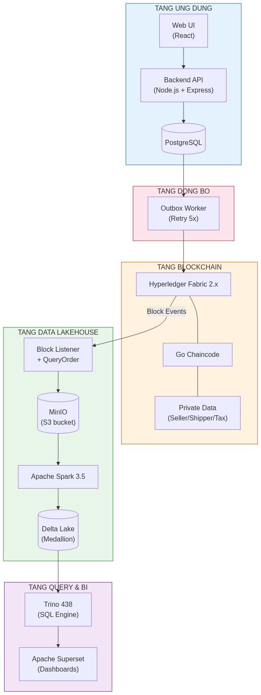
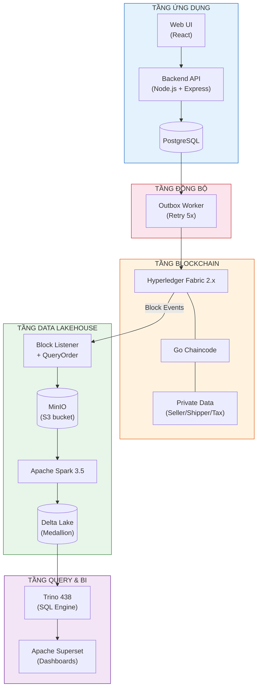
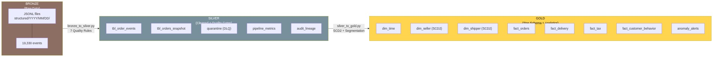
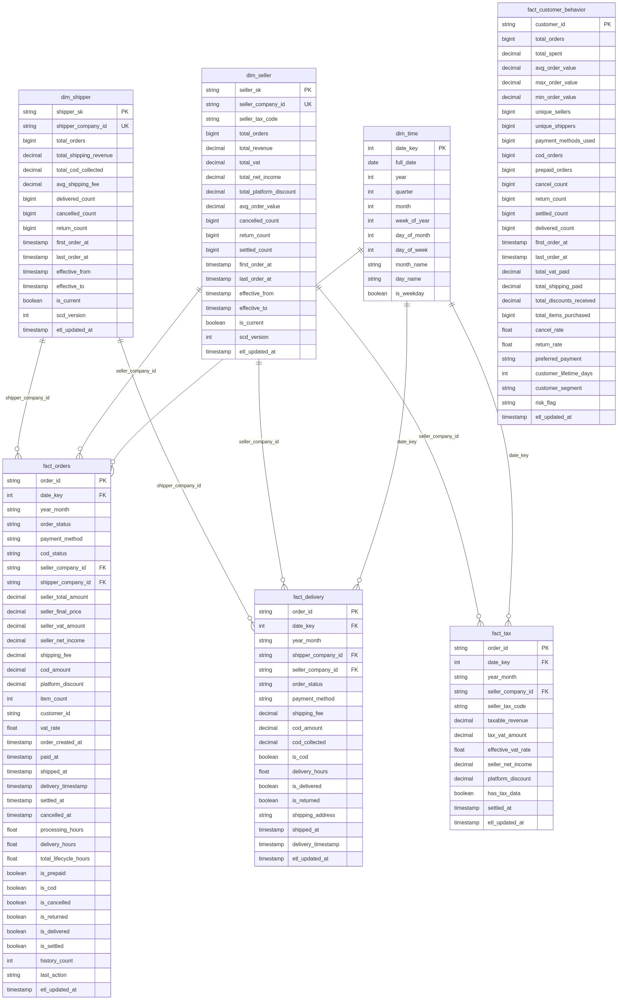
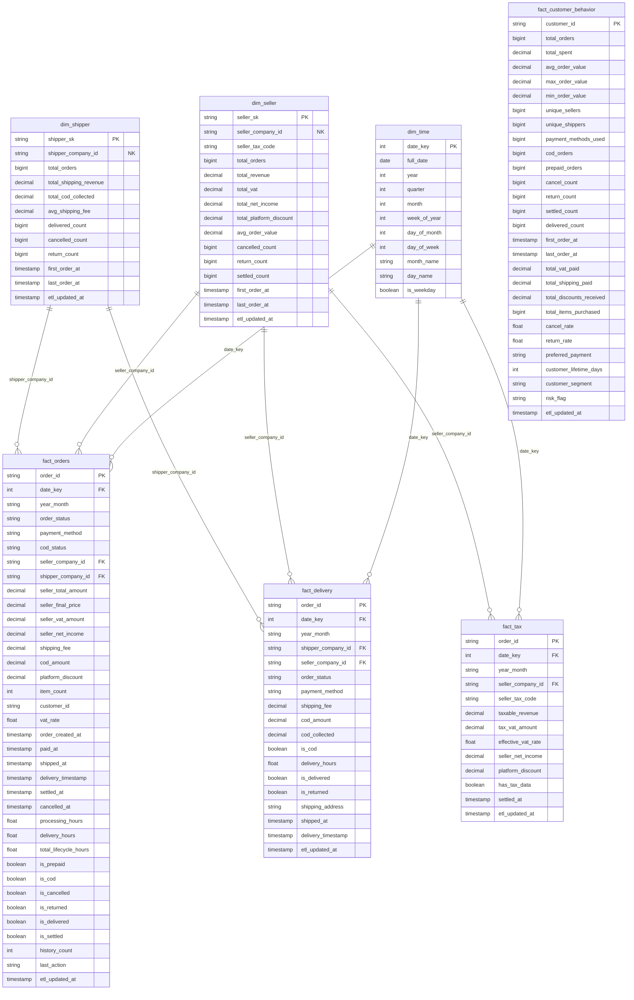
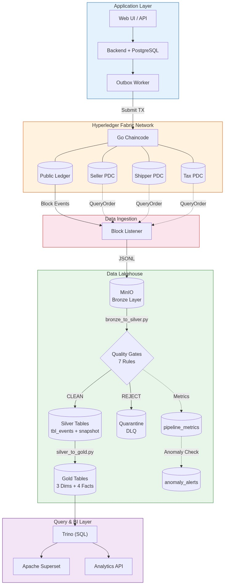
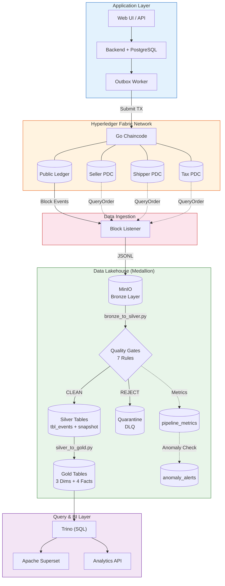

# TÀI LIỆU ĐẶC TẢ KIẾN TRÚC HỆ THỐNG (SYSTEM ARCHITECTURE SPECIFICATION)
*Dự án: E-commerce Blockchain Data Lakehouse*
*Phiên bản: V4 — Cập nhật 2026-05-31*

Tài liệu này mô tả chi tiết trạng thái hiện tại của hệ thống, luồng dữ liệu end-to-end, cấu trúc các lớp (layers) và các hạn chế kỹ thuật hiện tại.

---

## 1. TỔNG QUAN HỆ THỐNG (SYSTEM OVERVIEW)

Hệ thống là sự kết hợp giữa **Mạng Blockchain dùng riêng (Permissioned Blockchain)** để ghi nhận giao dịch không thể thay đổi, và **Kiến trúc Data Lakehouse** để lưu trữ, xử lý, và phân tích dữ liệu lớn.

### 1.1. Các tổ chức tham gia (Consortium)
Mạng Hyperledger Fabric (phiên bản 2.x) gồm 4 tổ chức (Organizations):
*   **ECommercePlatformOrg (Sàn TMĐT):** Điều phối toàn bộ quy trình đặt hàng, thanh toán, đối soát. Có quyền truy cập tất cả Private Data Collections.
*   **SellerOrg (Người bán):** Quản lý sản phẩm, doanh thu. Chỉ truy cập được `collectionSellerMarketplace`.
*   **ShipperOrg (Vận chuyển):** Quản lý giao hàng, thu COD. Chỉ truy cập được `collectionShipperMarketplace`.
*   **TaxOrg (Cơ quan thuế):** Kiểm tra thuế tự động. Chỉ truy cập được `collectionTaxMarketplace`.

### 1.2. Tech Stack (Công nghệ sử dụng)
| Lớp | Công nghệ | Phiên bản |
|-----|-----------|-----------|
| **Blockchain** | Hyperledger Fabric, Go Chaincode | 2.x |
| **Backend & Adapter** | Node.js, Express, PostgreSQL | Node 18+ |
| **Object Storage** | MinIO (S3-compatible) | RELEASE |
| **Data Processing** | Apache Spark, Delta Lake | 3.5.1, 3.1.0 |
| **Query Engine** | Trino (PrestoSQL) | 438 |
| **BI & Visualization** | Apache Superset | 3.x |
| **Metastore** | Apache Hive Metastore | 3.1.3 |
| **Containerization** | Docker Compose | 6 services |

### 1.3. Kiến trúc tổng thể (System Architecture Overview)



<details>
<summary><b>💻 Xem code Mermaid (Click để mở rộng)</b></summary>


</details>

---

## 2. CHI TIẾT CÁC TẦNG KIẾN TRÚC (ARCHITECTURE LAYERS)

### TẦNG 1: BLOCKCHAIN & SMART CONTRACT

Sử dụng mô hình lưu trữ kết hợp giữa **Public State** và **Private Data Collection (PDC)**.

#### 2.1.1. Public State (Ledger chung — `Order` struct)
Lưu trữ các thông tin không nhạy cảm, **tất cả 4 tổ chức đều xem được:**
| Trường | Kiểu | Mô tả |
|--------|------|-------|
| `orderID` | string | Mã đơn hàng duy nhất (VD: `ORD-1777866267974-A3172`) |
| `status` | string | Trạng thái: `CREATED`, `PAID`, `SHIPPED`, `DELIVERED`, `SETTLED`, `CANCELLED`, `RETURN_REQUESTED`, `RETURN_IN_TRANSIT`, `RETURNED` |
| `paymentMethod` | string | `PREPAID` hoặc `COD` |
| `codStatus` | string | `NOT_COLLECTED`, `PENDING_REMITTANCE`, `REMITTED` |
| `sellerCompanyID` | string | Mã công ty người bán |
| `shipperCompanyID` | string | Mã công ty vận chuyển |
| `vatRate` | float64 | Thuế suất GTGT (%) — được ghi tại thời điểm đối soát |
| `createdAt`...`returnCompletedAt` | string (RFC3339) | Các mốc thời gian vòng đời đơn hàng |
| `sellerDataHash`, `shipperDataHash`, `taxDataHash` | string (SHA-256) | Hash chống giả mạo dữ liệu PDC |
| `history[]` | array | Audit trail: `txID`, `timestamp`, `action`, `actorOrg`, `actorID` |

#### 2.1.2. Private Data Collections (PDC)

**`collectionSellerMarketplace`** — Chỉ Seller + Platform đọc được:
| Trường | Kiểu | Mô tả |
|--------|------|-------|
| `customerID` | string | Mã khách hàng |
| `items[]` | array | Chi tiết sản phẩm (productID, productName, unitPrice, quantity) |
| `TotalAmount` | float64 | Tổng giá trị hàng hóa (giá bán × số lượng) |
| `FinalPrice` | float64 | Thành tiền cuối cùng (bao gồm phí ship) |
| `vatAmount` | float64 | Thuế GTGT (hệ thống tự tính) |
| `sellerNetIncome` | float64 | Thu nhập ròng người bán |
| `platformDiscountAmount` | float64 | Chiết khấu sàn |
| `sellerTaxCode` | string | Mã số thuế người bán |

**`collectionShipperMarketplace`** — Chỉ Shipper + Platform đọc được:
| Trường | Kiểu | Mô tả |
|--------|------|-------|
| `shippingAddress` | string | Địa chỉ giao hàng |
| `phone` | string | Số điện thoại người nhận |
| `shippingFee` | float64 | Phí vận chuyển |
| `codAmount` | float64 | Tiền thu hộ (COD) |

**`collectionTaxMarketplace`** — Chỉ Tax + Platform đọc được (chỉ tồn tại khi đơn `SETTLED`):
| Trường | Kiểu | Mô tả |
|--------|------|-------|
| `sellerTaxCode` | string | Mã số thuế người bán |
| `taxableRevenue` | float64 | Doanh thu tính thuế |
| `vatAmount` | float64 | Thuế GTGT phải nộp |
| `transactionDate` | string | Ngày phát sinh doanh thu |
| `note` | string | Ghi chú (VD: Auto-calculated 2026 Regs) |

#### 2.1.3. Cơ chế Xác thực Thuế Tự động (Tax Validation)
Đây là đặc điểm nổi bật của hệ thống:
1.  **Backend tính toán:** Khi đối soát (`PayoutToSeller`), Backend tính `vatAmount = taxableRevenue × vatRate / 100` và truyền qua `transientData`.
2.  **Chaincode kiểm chứng:** Smart Contract đọc `VATRate` từ cấu hình On-chain (`TaxConfig`), tự tính lại thuế, so sánh với con số Backend đưa lên. Nếu sai lệch > 1.0 VND, giao dịch bị **từ chối ngay lập tức** với lỗi `"thuế GTGT không khớp"`.
3.  **Ghi chốt sổ:** Nếu hợp lệ, Chaincode ghi đè bản đối soát cuối cùng vào PDC Seller và PDC Tax. Hash được lưu vào Public State để chống giả mạo.
4.  **Hold Period:** Trước khi đối soát, hệ thống kiểm tra thời gian giữ tiền (`holdPeriodMinutes` từ `BusinessConfig`). Nếu chưa đủ thời gian kể từ khi giao hàng, giao dịch bị từ chối.

### TẦNG 2: BACKEND & BLOCKCHAIN ADAPTER

Đóng vai trò làm cầu nối giữa Web UI và Blockchain.

#### 2.2.1. PostgreSQL + Outbox Pattern
*   **PostgreSQL:** Lưu trữ trạng thái tạm thời (Optimistic State) để Web UI phản hồi nhanh mà không phải đợi Blockchain confirm.
*   **Outbox Worker:** Các lệnh thay đổi trạng thái được ghi vào bảng `blockchain_outbox`. Worker quét 10s/lần và gửi lên Blockchain. Nhận diện lỗi **Transient** (retry) và **Permanent** (skip + rollback).

#### 2.2.2. Block Listener — Cầu nối Blockchain → Data Lake
File: `blockchain-adapter/src/listeners/blockListener.js`

**Luồng xử lý mỗi block:**
1.  **Raw Backup:** Lưu nguyên block gốc → `raw/blocks/block_X.json`
2.  **Parse Transactions:** `blockParser.js` extract metadata (block_number, tx_id, function_name, creator_msp, is_valid...)
3.  **Data Enrichment (V2):** Với mỗi transaction hợp lệ, gọi `queryOrderData(orderID)`:
    *   `fabricContract.evaluateTransaction('QueryOrder', orderID)` → nhận `{ publicData, privateData, dataVerified }`
    *   Extract **publicData** → `tx.order_data` (status, timestamps, company IDs, history...)
    *   Extract **privateData** → `tx.private_data` (seller_data, shipper_data, tax_data)
4.  **Upload JSONL:** Đóng gói thành JSON Lines, upload MinIO theo partition: `structured/YYYY/MM/DD/events_block_X.jsonl`

**Cấu trúc 1 event trong JSONL:**
```json
{
  "block_number": 96,
  "tx_id": "66b23149...",
  "function_name": "PayoutToSeller",
  "creator_msp": "ECommercePlatformOrgMSP",
  "is_valid": true,
  "timestamp": "2026-05-01T16:21:59.079Z",
  "order_data": {
    "order_id": "ORD-xxx",
    "status": "SETTLED",
    "payment_method": "COD",
    "seller_company_id": "abc",
    "shipper_company_id": "Check",
    "vat_rate": 10,
    "created_at": "...", "settled_at": "...",
    "history_count": 5,
    "last_action": "PayoutToSeller"
  },
  "private_data": {
    "seller_data": { "TotalAmount": 95000, "vatAmount": 9500, ... },
    "shipper_data": { "shippingFee": 28750, "codAmount": 98750, ... },
    "tax_data": { "taxableRevenue": 95000, "vatAmount": 9500, ... }
  }
}
```

> **Lưu ý:** `tax_data` chỉ tồn tại khi đơn đã `SETTLED` (qua `PayoutToSeller`). Các trường timestamp (`paid_at`, `shipped_at`, `delivery_timestamp`...) là `null` nếu đơn chưa đạt đến trạng thái tương ứng (VD: `shipped_at = null` nếu đơn bị hủy trước khi giao).

### TẦNG 3: DATA LAKEHOUSE (MEDALLION ARCHITECTURE)

Xử lý dữ liệu song song bằng Apache Spark thông qua script `run_pipeline.sh`.

**Kiến trúc Medallion (Bronze → Silver → Gold):**

```mermaid
flowchart LR
    subgraph BRONZE["BRONZE<br/>(Raw Data)"]
        direction TB
        B1["JSONL files<br/> structured/YYYY/MM/DD/"]
        B2["19,330 events"]
        B1 --- B2
    end

    subgraph SILVER["SILVER<br/>(Cleaned + Quality Gates)"]
        direction TB
        S1["tbl_order_events"]
        S2["tbl_orders_snapshot"]
        S3["quarantine (DLQ)"]
        S4["pipeline_metrics"]
        S5["audit_lineage"]
    end

    subgraph GOLD["GOLD<br/>(Star Schema + Analytics)"]
        direction TB
        D1["dim_time"]
        D2["dim_seller (SCD2)"]
        D3["dim_shipper (SCD2)"]
        F1["fact_orders"]
        F2["fact_delivery"]
        F3["fact_tax"]
        F4["fact_customer_behavior"]
        F5["anomaly_alerts"]
    end

    BRONZE -->|"bronze_to_silver.py<br/>7 Quality Rules"| SILVER
    SILVER -->|"silver_to_gold.py<br/>SCD2 + Segmentation"| GOLD

    style BRONZE fill:#8d6e63,color:#fff
    style SILVER fill:#78909c,color:#fff
    style GOLD fill:#ffd54f,color:#000
```



<details>
<summary><b>💻 Xem code Mermaid (Click để mở rộng)</b></summary>


</details>

#### Lớp BRONZE (Raw Data)
*   **Nguồn:** File JSON Lines (JSONL) từ MinIO bucket `ecommerce-lakehouse/structured/`.
*   **Đặc điểm:** Dữ liệu nested, chứa `order_data` (Public State) và `private_data` (3 PDC collections). Mỗi file là 1 block, chứa 1-N transactions.
*   **Phân vùng:** Theo ngày: `structured/YYYY/MM/DD/events_block_X.jsonl`.

#### Lớp SILVER (Cleaned & Conformed)
Job Spark: `bronze_to_silver.py` — V4 Data Quality Framework

| Tính năng | Chi tiết |
|-----------|---------|
| **Flattening** | Rút trích trực tiếp từ `order_data.*` và `private_data.*`. Không suy luận status từ function_name (dùng `order_data.status` trực tiếp vì Adapter đã enrich đầy đủ). |
| **Incremental Processing** | Track `max(block_number)` từ `tbl_order_events`. Chỉ xử lý block mới → tiết kiệm thời gian chạy. |
| **Streaming Mode** | Hỗ trợ `--mode streaming` với Structured Streaming, trigger 30s, checkpoint trên S3. Streaming cũng áp dụng Quality Gates. |
| **Quality Gates (V4)** | 7 rules declarative (5 CRITICAL + 2 WARNING). CRITICAL → dữ liệu bị cách ly vào `quarantine` table. WARNING → vẫn vào Silver nhưng được ghi nhận. Rules: `order_id_not_null`, `valid_order_status`, `seller_exists`, `positive_amount`, `amount_not_null`, `timestamp_consistency`, `block_number_valid`. |
| **Quarantine / DLQ (V4)** | Dữ liệu vi phạm CRITICAL rules được tách ra bảng `quarantine` riêng (Dead Letter Queue). Mỗi row ghi nhận: `quarantine_reason`, `quarantine_severity`, `quarantine_description`, `quarantined_at`. Chỉ dữ liệu clean mới vào Silver. |
| **Schema Evolution (V4)** | Tự động phát hiện schema drift giữa batch mới và Delta table hiện có: cột mới thêm, cột bị mất, thay đổi data type. |
| **Pipeline Metrics (V4)** | Ghi metrics chi tiết mỗi step: `input_rows`, `output_rows`, `quarantine_rows`, `success_rate`, `duration_seconds`, `schema_changes`. Phục vụ anomaly detection. |
| **Snapshot Strategy** | Window Function `row_number()` lấy event có `block_number` lớn nhất cho mỗi `order_id`. Dùng `MERGE INTO` (Delta Lake) với condition `s.block_number >= t.block_number`. |

**Bảng Silver (5 tables):**
| Bảng | Loại | Mô tả |
|------|------|-------|
| `tbl_order_events` | Append-only | Toàn bộ sự kiện blockchain (Event Sourcing). **Chỉ chứa dữ liệu đã qua Quality Gates.** |
| `tbl_orders_snapshot` | Upsert | Trạng thái mới nhất của mỗi đơn hàng. 1 row = 1 order_id (latest block). |
| `quarantine` | Append | **(V4)** Dữ liệu lỗi bị cách ly. Ghi nhận lý do vi phạm. Admin review định kỳ. |
| `pipeline_metrics` | Append | **(V4)** Metrics mỗi step pipeline. Dùng cho anomaly detection. |
| `audit_lineage` | Append | ETL audit mở rộng: run_id, events_count, **clean_count, quarantine_count, clean_rate**, quality_summary, pipeline_version. |

**Format:** Delta Lake trên MinIO (`s3a://ecommerce-lakehouse/delta/silver/`).

#### Lớp GOLD (Business-level Aggregates / Star Schema)
Job Spark: `silver_to_gold.py` — V4 SCD2 + Customer Analytics + Anomaly Detection

**Dimension Tables (SCD Type 2):**
| Bảng | Merge Key | SCD | Chi tiết |
|------|-----------|-----|----------|
| `dim_time` | `date_key` | — | Calendar 2024-2027 (year, quarter, month, week, day, is_weekday) |
| `dim_seller` | `seller_company_id` | **Type 1** | Không có thuộc tính danh mục thay đổi chậm (`seller_tax_code` cố định từ lúc đăng ký) → chỉ áp dụng Type 1 (ghi đè metrics). |
| `dim_shipper` | `shipper_company_id` | **Type 1** | Không có thuộc tính danh mục thay đổi chậm → chỉ áp dụng Type 1 (ghi đè metrics). |

**Fact Tables (4 tables):**
| Bảng | Partition | Dùng cho | Chi tiết |
|------|-----------|----------|---------|
| `fact_orders` | `year_month` | Admin, Seller | Full order metrics: financial (revenue, VAT, net income, discount), lifecycle timestamps (created → settled), computed durations (processing_hours, delivery_hours, total_lifecycle_hours), flags (is_prepaid, is_cod, is_cancelled, is_returned, is_delivered, is_settled) |
| `fact_delivery` | `year_month` | Shipper | Chỉ đơn đã shipped. Metrics: delivery_hours, shipping_fee, cod_amount, cod_collected, is_delivered, is_returned, shipping_address |
| `fact_tax` | `year_month` | Tax Officer | Chỉ đơn đã settled (has_tax_data=true). Metrics: taxable_revenue, tax_vat_amount, effective_vat_rate, seller_tax_code |
| `fact_customer_behavior` | — | **(V4)** Admin | 20+ metrics phân tích hành vi khách hàng: total_spent, avg_order_value, unique_sellers, cancel_rate, return_rate, preferred_payment, customer_lifetime_days. **Segmentation:** PREMIUM (>5M), REGULAR (>1M), ACTIVE (>200K), NEW. **Risk flags:** HIGH_CANCEL (>50%), HIGH_RETURN (>30%). |

**Anomaly Detection (V4):**
| Bảng | Loại | Chi tiết |
|------|------|----------|
| `anomaly_alerts` | Append | So sánh pipeline run hiện tại với lịch sử (cần 3+ runs). 4 checks: Volume spike/drop (>2σ), Quality drop (>5% giảm), Duration spike (>3σ), Quarantine rate (>5%). Mỗi alert ghi: `alert_type`, `severity`, `message`, `metric_value`, `threshold`. |

**Format:** Delta Lake trên MinIO (`s3a://ecommerce-lakehouse/delta/gold/`).

#### Warehouse Star Schema — ERD chi tiết



<details>
<summary><b>💻 Xem code Mermaid (Click để mở rộng)</b></summary>


</details>

> **Ghi chú ERD:**
> - `PK` = Primary Key, `FK` = Foreign Key, `NK` = Natural Key (business key cho SCD2)
> - `dim_seller` và `dim_shipper` sử dụng **SCD Type 1**: mỗi lần thuộc tính thống kê thay đổi, bản ghi cũ được ghi đè trực tiếp, đảm bảo không bị bùng nổ dữ liệu.
> - `fact_customer_behavior` không có `date_key` vì là aggregate toàn bộ lịch sử của customer
> - Fact tables liên kết với dim tables qua `seller_company_id`, `shipper_company_id`, `date_key` (natural keys)

### TẦNG 4: QUERY & VISUALIZATION

#### 2.4.1. Trino (Query Engine)
*   **Catalog:** `delta` — mount vào MinIO qua Hive Metastore.
*   **Schemas:** `delta.silver` (5 tables), `delta.gold` (8 tables) = **13 tables tổng**.
*   **Port:** `8090` (host) → `8080` (container).
*   **Registration:** Bảng Delta được register qua `CALL delta.system.register_table(...)` trong pipeline script.

#### 2.4.2. Apache Superset (BI Dashboard)
*   **Port:** `8088`.
*   **Database Connection:** Trino via JDBC (`trino://trino:8080/delta`).
*   **11 Dataset queries** đã chuẩn bị cho 4 dashboards:

| Dashboard | Datasets | Chart Types |
|-----------|----------|-------------|
| **Admin Overview** | KPIs, Revenue by Month, Order Status, Payment Methods | Big Number, Line, Pie, Bar |
| **Seller Analytics** | Revenue per Seller, Order Details | Bar, Table |
| **Shipper Performance** | Delivery Overview, Delivery Details | Bar, Table, KPI |
| **Tax Compliance** | Tax Report, Per-Seller Tax Summary, Event Log | Table, Bar |

#### 2.4.3. Backend Analytics API
*   File: `backend-api/src/controllers/analyticsController.js`
*   **11 REST endpoints** query Trino REST API:

| Endpoint | Method | Tổ chức |
|----------|--------|---------|
| `/api/v1/analytics/admin/overview` | GET | Platform |
| `/api/v1/analytics/admin/revenue-by-month` | GET | Platform |
| `/api/v1/analytics/admin/order-status` | GET | Platform |
| `/api/v1/analytics/admin/payment-methods` | GET | Platform |
| `/api/v1/analytics/seller/overview` | GET | Platform/Seller |
| `/api/v1/analytics/seller/revenue?seller_id=x` | GET | Seller |
| `/api/v1/analytics/shipper/overview` | GET | Platform/Shipper |
| `/api/v1/analytics/shipper/delivery?shipper_id=x` | GET | Shipper |
| `/api/v1/analytics/tax/report` | GET | Tax Officer |
| `/api/v1/analytics/audit/events` | GET | Platform |
| `/api/v1/analytics/audit/order/:orderId` | GET | Platform |

---

## 3. PIPELINE ORCHESTRATION

### 3.1. ETL Pipeline (`run_pipeline.sh`)
Chạy hàng ngày lúc 2:00 AM qua crontab:
```
0 2 * * * ~/lakehouse/scripts/run_pipeline.sh >> /var/log/lakehouse-etl.log 2>&1
```

**Các bước:**
| Step | Mô tả | Thời gian (thực tế) |
|------|--------|---------------------|
| 0 | Ensure Trino schemas (`delta.silver`, `delta.gold`) | ~2s |
| 1 | Bronze → Silver V4 (Quality Gates + Quarantine + Metrics) | ~290s (first run) |
| 2 | Silver → Gold V4 (SCD2 + Customer Analytics + Anomaly) | ~134s |
| 3 | Register 13 Delta tables trong Trino | ~5s |
| 4 | Quick Validation (row counts cho 7 tables + quarantine) | ~3s |

**Tính năng:**
*   Error handling per step với error messages.
*   Duration tracking (phút:giây).
*   Incremental: lần chạy thứ 2+ skip nếu không có block mới.
*   **(V4)** Step-level metrics ghi vào `pipeline_metrics` table.
*   **(V4)** Anomaly detection tự động sau mỗi Gold build (cần 3+ runs lịch sử).

### 3.2. Delta Maintenance (`run_maintenance.sh`)
Chạy hàng tuần (Chủ Nhật 3:00 AM):
```
0 3 * * 0 ~/lakehouse/scripts/run_maintenance.sh >> /var/log/lakehouse-maint.log 2>&1
```
Thực hiện `OPTIMIZE` (compact small files) + `VACUUM` (xóa old versions) cho tất cả Delta tables.

---

## 4. HẠ TẦNG (INFRASTRUCTURE)

### 4.1. Docker Compose Stack
| # | Service | Image | Port | Vai trò |
|---|---------|-------|------|---------|
| 1 | `metastore-db` | postgres:15-alpine | (internal) | PostgreSQL cho Hive Metastore |
| 2 | `hive-metastore` | custom build | 9083 | Apache Hive Metastore 3.1.3 |
| 3 | `spark` | custom build | 7077, 8081, 4040 | Spark Master |
| 4 | `spark-worker` | custom build | (internal) | Spark Worker |
| 5 | `trino` | trinodb/trino:438 | 8090 | Query Engine |
| 6 | `superset` | custom build | 8088 | BI Dashboards |

*   **Network:** `fabric_ecommerce_network` (external, shared với blockchain network).
*   **Volumes:** `metastore-pgdata` (Hive DB), `superset-data` (Superset home).
*   **MinIO:** Tái sử dụng instance từ blockchain network (bucket: `ecommerce-lakehouse`).

### 4.2. Luồng Dữ liệu End-to-End (V4)



<details>
<summary><b>💻 Xem code Mermaid (Click để mở rộng)</b></summary>


</details>

---

## 5. ĐÁNH GIÁ KIẾN TRÚC

### 5.1. Điểm mạnh đã đạt được
1.  **Blockchain-native data enrichment:** Block Listener gọi `QueryOrder` lấy cả `publicData` + `privateData`, đảm bảo JSONL đầy đủ. Không cần suy luận status hay fill-gaps.
2.  **Incremental ETL:** Track `max(block_number)`, chỉ xử lý block mới. Pipeline lần 2+ nhanh gần như tức thì nếu không có block mới.
3.  **Delta Lake MERGE INTO:** Upsert snapshot hiệu quả (không full overwrite). Condition `s.block_number >= t.block_number` kết hợp tiebreaker `tx_index` đảm bảo chỉ cập nhật khi có event mới hơn.
4.  **Data Quality Framework (V4):** 7 quality rules declarative (CRITICAL/WARNING). Dữ liệu lỗi bị cách ly vào `quarantine` table (Dead Letter Queue) — chỉ dữ liệu clean mới vào Silver. Nguyên tắc "garbage in, garbage out" được loại bỏ triệt để.
5.  **Multi-Org Star Schema:** 3 Dimensions + **4 Facts** phục vụ 5 góc nhìn phân tích cho 4 tổ chức khác nhau, với partitioning theo `year_month`.
6.  **Xác thực thuế On-chain:** Smart Contract đọc `VATRate` từ cấu hình on-chain, tự tính lại và so sánh với Backend. Sai lệch >1 VND → từ chối giao dịch.
7.  **Audit Trail đầy đủ:** `history[]` trên blockchain + `tbl_order_events` (Event Sourcing) + `audit_lineage` (ETL lineage với clean_rate, quarantine_count).
8.  **Outbox Pattern:** Đồng bộ bất đồng bộ với retry (5 phút/lần, tối đa 5 lần), phân biệt lỗi Permanent (skip) và Transient (retry).
9.  **SCD Type 1 cho Dimensions (V4):** `dim_seller` và `dim_shipper` đều áp dụng SCD Type 1 (ghi đè chỉ số thống kê) vì không có thuộc tính danh mục thay đổi chậm trong phạm vi hệ thống hiện tại.
10. **Customer Analytics (V4):** `fact_customer_behavior` với 20+ metrics, auto-segmentation (PREMIUM/REGULAR/ACTIVE/NEW), risk flags (HIGH_CANCEL/HIGH_RETURN). Khai thác `customer_id` có sẵn từ blockchain PDC.
11. **Pipeline Observability (V4):** Bảng `pipeline_metrics` ghi step-level metrics (input/output/quarantine/duration). Schema evolution detection phát hiện thay đổi cấu trúc giữa các batch.
12. **Anomaly Detection (V4):** So sánh pipeline run hiện tại với lịch sử thống kê (σ-based). 4 checks: volume spike/drop (>2σ), quality drop, duration spike (>3σ), quarantine rate. Alerts ghi vào `anomaly_alerts` table.

---

## 6. HẠN CHẾ CỦA ĐỀ TÀI

> Mục này phân tích trung thực các giới hạn kiến trúc hiện tại. Đây là các vấn đề đã được nhận diện nhưng **nằm ngoài phạm vi KLTN** do hạn chế về kinh phí, tài nguyên máy chủ (1 VM), và thời gian triển khai.

### 6.1. Block Listener là Single Point of Failure (SPOF)
**Hiện trạng:** Block Listener chạy dạng single-instance trong Node.js process. Nếu process crash, restart, hoặc mất kết nối Fabric, các block trong khoảng thời gian đó **sẽ bị mất** và không được ghi vào MinIO.

**Hệ quả:** Dữ liệu Bronze thiếu sót → Silver/Gold thiếu events → báo cáo BI không chính xác.

**Giải pháp hướng tới:** Đưa block events vào **Apache Kafka** làm buffer trung gian. Consumer đọc từ Kafka với idempotent processing (check `block_number` đã xử lý chưa). Kafka đảm bảo at-least-once delivery và cho phép replay.

**Chấp nhận được vì:** Môi trường lab với traffic thấp, có `backfillBlocks.js` để replay lại các block đã mất.

### 6.2. Private Data lưu Plaintext trong MinIO
**Hiện trạng:** Dữ liệu từ 3 Private Data Collections (seller, shipper, tax) được Block Listener giải mã và lưu dạng plaintext JSON trong MinIO bucket `ecommerce-lakehouse`. Bất kỳ ai có credentials MinIO đều đọc được toàn bộ thông tin tài chính, địa chỉ khách hàng, mã số thuế.

**Hệ quả:** Đây là **lỗ hổng kiến trúc nghiêm trọng nhất** về mặt bảo mật. Mục đích thiết kế PDC trên Hyperledger Fabric (data isolation per org) bị mất hoàn toàn khi dữ liệu được flatten vào cùng 1 bucket.

**Giải pháp production cần:**
*   **Bucket isolation:** Mỗi org 1 bucket riêng (`seller-data/`, `shipper-data/`, `tax-data/`), credentials khác nhau.
*   **Encryption at rest:** MinIO Server-Side Encryption (SSE-S3 hoặc SSE-KMS).
*   **Access Control:** Apache Ranger hoặc MinIO Policy cho row-level access.

**Chấp nhận được vì:** Hệ thống hoạt động trong mạng nội bộ (Docker network), chỉ Platform Admin có credentials MinIO. Phù hợp với môi trường demo/lab.

### 6.3. Pipeline Orchestration thủ công
**Hiện trạng:** ETL pipeline được điều phối bằng `run_pipeline.sh` + `crontab`. Không có:
*   DAG quản lý dependency giữa các bước (nếu Step 1 fail, Step 2 vẫn chạy nếu không check exit code).
*   Retry logic cho từng bước riêng biệt.
*   Visual monitoring/alerting (phải đọc log file thủ công).
*   Backfill theo time range (phải chạy lại toàn bộ).

**Giải pháp hướng tới:** **Apache Airflow** với DAG: `bronze_to_silver >> silver_to_gold >> trino_register >> validate`. Airflow cung cấp retry, SLA alerting, và backfill UI.

**Chấp nhận được vì:** Pipeline hiện tại chạy ổn định với 1 VM, ~2 phút/run. Bash script + incremental processing đủ dùng cho quy mô demo.

### ~~6.4. Data Quality chỉ Báo cáo, chưa Cách ly~~ → ĐÃ GIẢI QUYẾT (V4)
**Đã triển khai:** Quality Gates Framework với 7 rules declarative + Quarantine table (DLQ). Dữ liệu lỗi bị cách ly hoàn toàn khỏi Silver. Chi tiết tại mục 2.3 (Lớp Silver).

### ~~6.5. Slowly Changing Dimensions (SCD Type 1)~~ → ĐÃ GIẢI QUYẾT (V4)
**Đã triển khai:** `dim_seller` và `dim_shipper` đều áp dụng SCD Type 1 (ghi đè) vì không có thuộc tính danh mục thay đổi chậm trong phạm vi hệ thống hiện tại (`seller_tax_code` cố định từ lúc đăng ký).

---

## 7. HƯỚNG PHÁT TRIỂN VÀ MỞ RỘNG

### 7.1. Đã triển khai trong V4
| # | Tính năng | Trạng thái | Mô tả |
|---|-----------|-----------|-------|
| 1 | DLQ / Quarantine table | ✅ Hoàn thành | 7 quality rules, Dead Letter Queue, chỉ dữ liệu clean vào Silver |
| 2 | SCD Type 2 cho Dimensions | ✅ Hoàn thành | `dim_seller` + `dim_shipper` lưu lịch sử thay đổi |
| 3 | Customer Analytics | ✅ Hoàn thành | `fact_customer_behavior` với segmentation + risk flags |
| 4 | Pipeline Observability | ✅ Hoàn thành | Step-level metrics + schema evolution detection |
| 5 | Anomaly Detection | ✅ Hoàn thành | Statistical anomaly detection (σ-based) trên pipeline health |

### 7.2. Hướng mở rộng tương lai
| # | Hướng phát triển | Độ phức tạp | Tài nguyên cần | Mô tả |
|---|------------------|-------------|----------------|-------|
| 1 | Kafka buffer cho Block Listener | Trung bình | Kafka cluster (3 nodes) | Loại bỏ SPOF, hỗ trợ replay, at-least-once delivery |
| 2 | MinIO bucket isolation + encryption | Trung bình | Cấu hình MinIO | Bảo vệ PDC data đúng thiết kế Fabric |
| 3 | Apache Airflow orchestration | Cao | VM riêng (4GB RAM) | DAG management, retry, SLA, visual monitoring |
| 4 | CDC từ PostgreSQL (Debezium) | Cao | Kafka + Debezium | Join hành vi user trên Web UI với dữ liệu on-chain |
| 5 | Row-Level Security (Superset) | Thấp | Cấu hình Superset | Giới hạn data theo org (seller chỉ thấy data của mình) |
| 6 | Real-time Streaming (Spark) | Cao | VM mạnh hơn (8GB+) | `bronze_to_silver.py --mode streaming` đã viết sẵn, cần tài nguyên |

