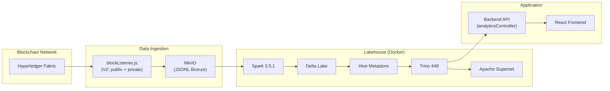
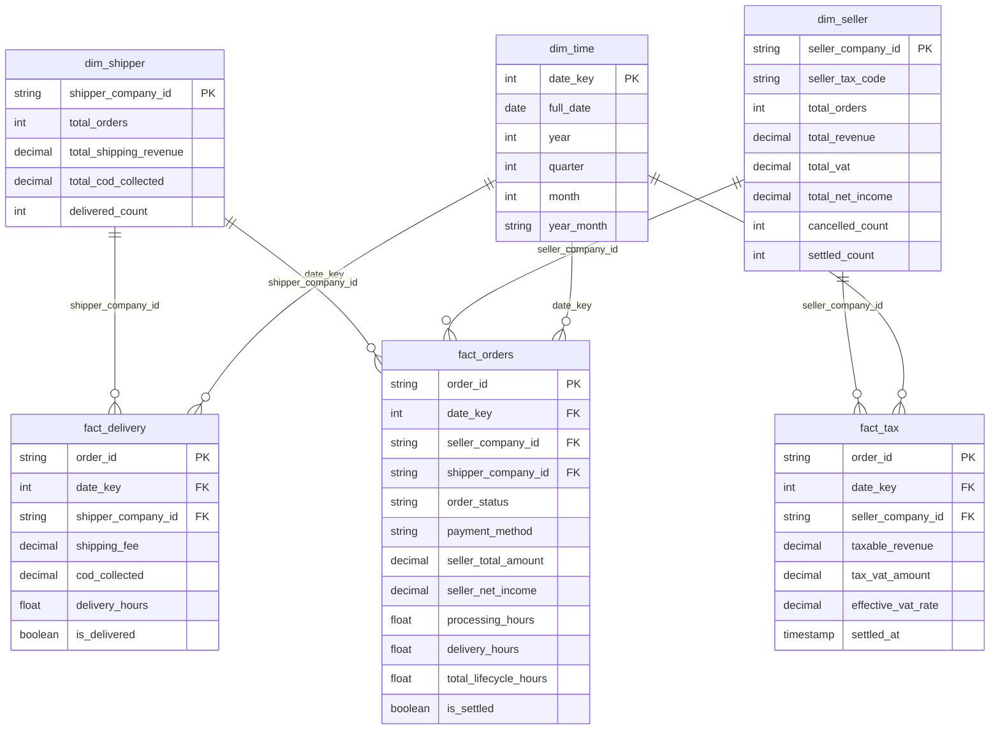

# Lakehouse Data Platform — Implementation Plan V3

## Architecture



## Data Flow

| Layer | Format | Tables |
|---|---|---|
| **Bronze** | JSONL (MinIO) | `structured/{year}/{month}/{day}/events_block_{N}.jsonl` |
| **Silver** | Delta Lake | `tbl_order_events`, `tbl_orders_snapshot`, `audit_lineage` |
| **Gold** | Delta Lake | `dim_time`, `dim_seller`, `dim_shipper`, `fact_orders`, `fact_delivery`, `fact_tax` |

## Gold Layer — Dimensional Model



## Org Dashboards & API Endpoints

### Admin / Platform
| Endpoint | Purpose |
|---|---|
| `GET /analytics/admin/overview` | KPIs: revenue, orders, VAT, payment split |
| `GET /analytics/admin/revenue-by-month` | Monthly trend |
| `GET /analytics/admin/order-status` | Status distribution |
| `GET /analytics/admin/payment-methods` | PREPAID vs COD |

### Seller
| Endpoint | Purpose |
|---|---|
| `GET /analytics/seller/overview` | All sellers comparison |
| `GET /analytics/seller/revenue?seller_id=X` | Seller-specific orders + summary |

### Shipper
| Endpoint | Purpose |
|---|---|
| `GET /analytics/shipper/overview` | All shippers comparison |
| `GET /analytics/shipper/delivery?shipper_id=X` | Delivery performance + COD |

### Tax Officer
| Endpoint | Purpose |
|---|---|
| `GET /analytics/tax/report` | Tax compliance (settled orders only) |

### Blockchain Audit
| Endpoint | Purpose |
|---|---|
| `GET /analytics/audit/events` | Event timeline |
| `GET /analytics/audit/order/:orderId` | Order lifecycle trace |

## Pipeline Schedule

| Schedule | Script | Purpose |
|---|---|---|
| Daily 2AM | `run_pipeline.sh` | ETL: Bronze→Silver→Gold + Trino register |
| Manual | `run_maintenance.sh` | OPTIMIZE + VACUUM Delta tables |

---

## Remaining Tasks (KLTN Final Phase)

### ✅ Đã hoàn thành
- [x] blockListener V2 (public + private data enrichment)
- [x] bronze_to_silver V3 (incremental, tiebreaker, quality checks)
- [x] silver_to_gold V3 (dim_shipper, fact_delivery, removed risk scoring)
- [x] run_pipeline.sh (error handling, validation step)
- [x] backfillBlocks.js (V2 format, queryOrderData)
- [x] outboxWorker.js (retry delay 5 min, isProcessing fix)
- [x] analyticsController.js (11 endpoints, 4 org dashboards)
- [x] SYSTEM_ARCHITECTURE.md (V3, hạn chế + hướng phát triển)

### 🔧 Cần làm trên VM

#### Task 1: Deploy updated files
```bash
# Copy từ local lên VM
scp blockchain-adapter/src/listeners/blockListener.js    VM:~/QnT/blockchain-adapter/src/listeners/
scp blockchain-adapter/src/listeners/backfillBlocks.js   VM:~/QnT/blockchain-adapter/src/listeners/
scp backend-api/src/workers/outboxWorker.js              VM:~/QnT/backend-api/src/workers/
scp lakehouse/spark/jobs/bronze_to_silver.py             VM:~/lakehouse/spark/jobs/
scp lakehouse/spark/jobs/silver_to_gold.py               VM:~/lakehouse/spark/jobs/
scp lakehouse/scripts/run_pipeline.sh                    VM:~/lakehouse/scripts/
scp lakehouse/scripts/run_maintenance.sh                 VM:~/lakehouse/scripts/
chmod +x ~/lakehouse/scripts/*.sh
```

#### Task 2: Backfill old blocks
```bash
cd ~/QnT/blockchain-adapter
node src/listeners/backfillBlocks.js --with-private
```
> Re-process raw blocks cũ (trước fix blockListener) → viết lại JSONL với đầy đủ order_data + private_data.

#### Task 3: Clean Delta + chạy pipeline mới
```bash
cd ~/lakehouse

# Xóa old Delta tables (schema đã thay đổi)
docker compose exec -T spark bash -c "
  hadoop fs -rm -r -f s3a://ecommerce-lakehouse/delta/silver/
  hadoop fs -rm -r -f s3a://ecommerce-lakehouse/delta/gold/
"

# Drop old Trino registrations
docker compose exec -T trino trino --execute "
  DROP TABLE IF EXISTS delta.silver.tbl_order_events;
  DROP TABLE IF EXISTS delta.silver.tbl_orders_snapshot;
  DROP TABLE IF EXISTS delta.silver.audit_lineage;
  DROP TABLE IF EXISTS delta.gold.dim_seller;
  DROP TABLE IF EXISTS delta.gold.dim_shipper;
  DROP TABLE IF EXISTS delta.gold.dim_time;
  DROP TABLE IF EXISTS delta.gold.fact_orders;
  DROP TABLE IF EXISTS delta.gold.fact_delivery;
  DROP TABLE IF EXISTS delta.gold.fact_tax;
" 2>/dev/null

# Chạy pipeline từ đầu
./scripts/run_pipeline.sh
```

#### Task 4: Setup Superset
```bash
cd ~/lakehouse
./scripts/setup-superset.sh
```
Mở `http://<VM_IP>:8088` → tạo datasets + charts + 4 dashboards (Admin, Seller, Shipper, Tax).
Xem queries trong `scripts/superset-dashboards.sql`.

#### Task 5: Setup cron
```bash
crontab -e
# Thêm:
0 2 * * * /home/hadoopquynhthu/lakehouse/scripts/run_pipeline.sh >> /var/log/lakehouse-etl.log 2>&1
```

#### Task 6: End-to-end verification
1. Tạo đơn hàng mới → đưa qua full lifecycle
2. Chạy `run_pipeline.sh` → verify incremental processing
3. Check Trino queries + Superset dashboards + Analytics API

---

## V3 Changes (from V2)

1. **blockListener.js**: Extract `publicData` from `QueryOrder` (fills sellerCompanyID, timestamps, status)
2. **bronze_to_silver.py**: Simplified — no derived status, no fill-gaps; tiebreaker `tx_index`; incremental
3. **silver_to_gold.py**: Added `dim_shipper`, `fact_delivery`; removed risk scoring from `fact_tax`
4. **run_pipeline.sh**: Removed OPTIMIZE step (moved to manual); added validation
5. **outboxWorker.js**: Fixed `isProcessing` deadlock; retry delay 5 min; immediate startup
6. **backfillBlocks.js**: V2 format — `queryOrderData()` returns `order_data` + `private_data`
7. **analyticsController.js**: Added shipper endpoints, seller overview, payment method stats
